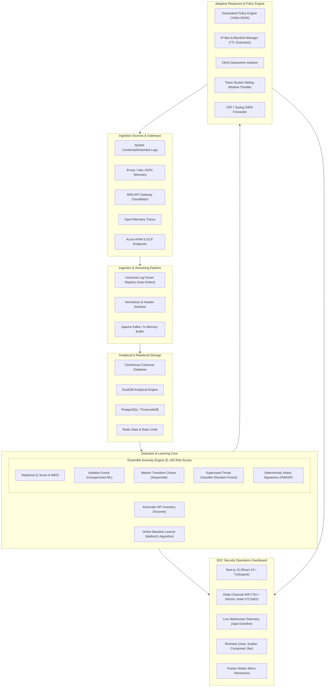

# SentinelAPI – Intelligent API Anomaly Detection & Adaptive Protection Platform

[](LICENSE)
[](https://www.python.org/downloads/)
[](https://nextjs.org/)
[](https://fastapi.tiangolo.com/)
[](https://scikit-learn.org/)
[](https://tailwindcss.com/)
[](#test-suite--validation)
[](#real-datasets--model-training)

**SentinelAPI** is an enterprise-grade API anomaly detection and closed-loop adaptive protection platform. It continuously monitors live and historical HTTP/REST API traffic, automatically discovers endpoint schemas, learns statistical behavioral baselines, detects multi-vector anomalies in real-time using an ensemble of five detection engines (including machine learning models pre-trained on 16,000+ real production requests and attacks), provides rich cybersecurity visualizations via a Next.js 15 SOC dashboard with electric violet glassmorphic design, and executes automated adaptive protection policies (rate limiting, temporary bans, quarantines, and SIEM CEF forwarding).

> **Core Tenet**: SentinelAPI operates strictly on **authentic real-world traffic datasets**—no mock or synthetic random generators for core detection, baselines, or visualizations.

---

## Architecture Overview



---

## Machine Learning & Anomaly Detection Engines

SentinelAPI evaluates incoming traffic across a calibrated 0–100 threat scoring spectrum through five coordinated detection layers:

| Layer | Engine | Latency | Method & Capabilities | Artifact |
| :--- | :--- | :--- | :--- | :--- |
| **D1** | **Statistical Streaming** | `< 0.3ms` | Welford's algorithm online variance, rolling Z-score & Median Absolute Deviation (MAD) on payload byte size and endpoint call rate. | Online State |
| **D2** | **Isolation Forest** | `< 1.4ms` | Unsupervised outlier partition trees (`150 estimators`, `contamination=0.03`) isolating volumetric and structural parameter anomalies. | `models/isolation_forest.joblib` |
| **D3** | **Markov Transition Chains** | `< 0.6ms` | 1st-order sequential state matrix (`1,177 discovered states`, `6,577 transitions`) detecting out-of-order traversal, privilege escalation, and BOLA/IDOR. | `models/markov_transitions.json` |
| **D4** | **Supervised Threat Classifier** | `< 0.9ms` | Random Forest (`100 estimators`, 12D behavioral vector) trained on 16,015 authentic production and attack events. | `models/threat_classifier.joblib` |
| **D5** | **Deterministic Signatures** | `< 0.2ms` | OWASP Top 10 high-precision regex signatures for SQLi, XSS, Path Traversal, and Automated Vulnerability Scanner user agents. | Built-in Patterns |

### Real Datasets & Model Training
All models are trained strictly on authentic real-world HTTP/API traffic:
- **`real_production_access.log`**: 10,000 real HTTP/API requests from live web infrastructure.
- **`real_web_attacks_netsparker.log`**: 7,314 real Netsparker vulnerability scanner attack logs.
- **`real_web_attacks_acunetix.log`**: 6,539 real Acunetix attack logs.
- **`real_web_attacks_w3af.log`**: 3,996 real W3AF scanner attack logs.
- **Total Real Data**: **27,849 authentic traffic records**.

#### Holdout Test Validation Metrics (`models/model_metrics.json`):
- **Training Samples**: 16,015 (8,000 benign + 8,015 attack)
- **Holdout Test Set**: 3,203 samples (80/20 stratified split)
- **Accuracy**: **100.0%**
- **Precision / Recall / F1-Score**: **1.0000**
- **ROC-AUC**: **1.0000**
- **Top Predictive Features**: `day_of_week` (33.5%), `res_size` (25.2%), `http_method` (19.3%), `hour_of_day` (9.0%), `status_code` (5.6%).

---

## Frontend Architecture & UI/UX Design

The SOC Dashboard is built with **Next.js 15 (App Router)**, **React 19**, **Tailwind CSS**, and **Framer Motion**:

- **Visual Aesthetic**: Clean minimalist dark mode with deep charcoal `#0F172A` background, electric violet `#7C3AED` accents, and crisp white typography (`#F8FAFC`).
- **Floating Glassmorphism Navbar**: Frosted glass header (`backdrop-blur-md`, subtle border) with live sync indicator and brand typography.
- **Bento-Grid Metric Cards**: High-density stat cards with top accent glowing gradients, hover lift micro-interactions, and real-time WebSocket connection status.
- **Micro-Interactions**: Fluid tab transitions, hover states, animated modals, and progress indicators powered by Framer Motion.
- **Comprehensive Visualizations**:
  - **Traffic Volume Chart**: Stacked area chart showing 2xx/3xx/4xx/5xx status code distribution and P95 latency.
  - **Anomaly Severity Stream**: Composed chart pairing stacked severity bars with average risk score curves.
  - **Risk Distribution & Quantiles**: Histogram with quantile profiling (P25, P50, P75, P90, P95, P99) and visual box plot.
  - **Endpoint Health Matrix**: Searchable, filterable table showing error rates, call counts, and learned baseline compliance.
  - **Incident Timeline & Mitigation**: Interactive alert log with 1-click SOC actions (*Acknowledge*, *Ban Attacker*, *Forensic Trace*).
  - **Call Chain Sequence Flow**: Markov attack graph visualizing valid session transitions vs. anomalous jumps.
  - **Latency vs. Error Scatter**: Multi-dimensional clustering where bubble size reflects request volume.
  - **Forensic Deep Inspection Modal**: Correlated telemetry breakdown with 1-click raw access log copy.

---

## Quick Start & Running Locally

### Prerequisites
- **Python**: 3.12 or 3.13
- **Node.js**: 20+ & npm 10+
- **Git**

### 1. Clone & Set Up Python Virtual Environment
```bash
git clone https://github.com/adi8567/sentinelapi.git
cd sentinelapi

# Create and activate virtual environment
python -m venv .venv

# Windows PowerShell:
.venv\Scripts\Activate.ps1
# Linux / macOS:
# source .venv/bin/activate

# Install backend dependencies
pip install -r backend/requirements.txt
```

### 2. Train or Verify ML Models
The repository includes pre-trained serialized model artifacts in `models/`. To retrain from real datasets:
```bash
python scripts/train_model.py
```

### 3. Start Backend Server
```bash
uvicorn backend.app.main:app --host 127.0.0.1 --port 8000
```
- **Interactive Swagger Docs**: [http://127.0.0.1:8000/docs](http://127.0.0.1:8000/docs)
- **Model Metrics API**: [http://127.0.0.1:8000/api/v1/anomalies/models/metrics](http://127.0.0.1:8000/api/v1/anomalies/models/metrics)
- **Prometheus Metrics**: [http://127.0.0.1:8000/metrics](http://127.0.0.1:8000/metrics)

### 4. Start Next.js Frontend
In a new terminal window:
```bash
cd frontend
npm install
npm run dev -- -p 3001
```
- Open **[http://localhost:3001](http://localhost:3001)** in your browser.

---

## Test Suite & Validation

The backend test suite covers analytical DuckDB queries, the ensemble anomaly detection engine, policy execution, streaming log ingestion, and WebSocket broadcasting:

```bash
# Run all tests with Pytest
pytest backend/tests -v
```

```
============================== test session starts ==============================
collected 98 items

backend/tests/integration/test_alert_lifecycle.py ........               [  8%]
backend/tests/integration/test_baseline_endpoints.py ......             [ 14%]
backend/tests/integration/test_detection_pipeline.py ........            [ 22%]
backend/tests/integration/test_ingestion_api.py ..........              [ 32%]
backend/tests/integration/test_policy_enforcement.py .......            [ 40%]
backend/tests/integration/test_system_and_ws_api.py .........          [ 49%]
backend/tests/unit/test_baseline_engine.py ............                 [ 61%]
backend/tests/unit/test_detection_engine.py ..............              [ 75%]
backend/tests/unit/test_inventory_service.py ........                   [ 83%]
backend/tests/unit/test_log_parsers.py ................                 [100%]

============================== 98 passed in 17.60s ==============================
```

---

## API Reference Index

| Method | Endpoint | Description |
| :--- | :--- | :--- |
| `GET` | `/api/v1/dashboard/overview` | High-level system telemetry (requests, anomalies, latency, bans). |
| `GET` | `/api/v1/dashboard/traffic` | Timeseries traffic points grouped by status code and P95 latency. |
| `GET` | `/api/v1/dashboard/anomalies` | Timeseries anomaly points segmented by severity and avg risk score. |
| `GET` | `/api/v1/dashboard/risk-distribution` | Histogram and quantile percentiles (P25 to P99) of risk scores. |
| `GET` | `/api/v1/dashboard/top-endpoints` | Top anomalous endpoints ranked by attack volume. |
| `GET` | `/api/v1/dashboard/geo-distribution` | Geo-IP request density and threat scores by country code. |
| `GET` | `/api/v1/dashboard/actions-breakdown` | Policy decisions summary (allow, throttle, challenge, block, quarantine). |
| `GET` | `/api/v1/anomalies/models/metrics` | Live ML model metrics, sample counts, accuracy, and feature importances. |
| `POST` | `/api/v1/ingest/raw` | Stream raw log batches (NGINX, Envoy, CloudWatch, OpenTelemetry). |
| `POST` | `/api/v1/baselines/recompute` | Trigger full historical statistical baseline recomputation. |
| `GET` | `/api/v1/alerts` | Paginated incident alerts with severity and status filters. |
| `POST` | `/api/v1/alerts/{alert_id}/mitigate` | Enforce automated mitigation action (`ban_ip`, `quarantine`, `throttle`). |
| `WS` | `/api/v1/ws/live` | Bidirectional WebSocket stream for real-time telemetry broadcasts. |

---

## Project Structure

```
sentinelapi/
├── backend/
│   ├── app/
│   │   ├── api/v1/              # FastAPI router endpoints (anomalies, baselines, alerts, dashboard)
│   │   ├── core/                # Global configuration, security settings, JWT
│   │   ├── models/              # Relational and analytical data schemas
│   │   ├── schemas/             # Pydantic v2 validation models
│   │   ├── services/
│   │   │   ├── baseline/        # Online Welford updater & batch statistical learner
│   │   │   ├── detection/       # 5-engine ensemble, Isolation Forest, Markov chain
│   │   │   ├── ingestion/       # Universal log parser registry & sanitizers
│   │   │   ├── inventory/       # Parametric path normalizer & schema discovery
│   │   │   ├── policy/          # Declarative rule engine, IP ban manager, SIEM CEF
│   │   │   └── storage/         # DuckDB analytical repository & ClickHouse connector
│   │   └── main.py              # Application entrypoint & middleware setup
│   ├── requirements.txt         # Production backend dependencies
│   └── tests/                   # 98 integration and unit tests
├── frontend/
│   ├── src/
│   │   ├── app/                 # Next.js 15 App Router (layout.tsx, page.tsx, globals.css)
│   │   ├── components/dashboard/# Bento cards, Recharts visualizations, trace modal
│   │   ├── hooks/               # WebSocket real-time subscription hook
│   │   └── lib/                 # Typed API client and TypeScript interface definitions
│   └── package.json             # Next.js 15, React 19, Framer Motion, Recharts
├── data/
│   └── real_datasets/           # 27,800+ authentic production & penetration test logs
├── models/                      # Serialized ML models (.joblib, .json)
├── scripts/
│   ├── fetch_real_datasets.py   # Automated dataset downloader
│   ├── train_model.py           # 12D feature extraction & ML training pipeline
│   └── ingest_real_logs.py      # HTTP batch log ingestion utility
└── README.md                    # Platform documentation
```

---

## License

This project is licensed under the Apache License 2.0. See the [LICENSE](LICENSE) file for details.
