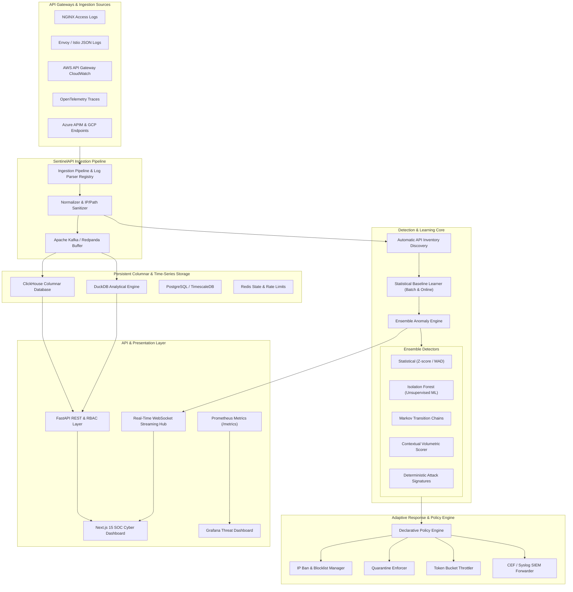

# SentinelAPI Platform Architecture & Technical Reference

SentinelAPI is an enterprise-grade, intelligent API anomaly detection and closed-loop adaptive protection platform designed for continuous, high-throughput monitoring of production API ecosystems.

---

## 1. High-Level System Architecture

---

## 2. Core Architectural Components

### 2.1 Ingestion & Normalization Engine
- **Universal Multi-Format Log Parsing**: Auto-detects and parses NGINX combined/extended logs, Envoy structured JSON, AWS API Gateway CloudWatch logs, Azure APIM, Google Cloud Endpoints, and OpenTelemetry distributed traces.
- **Data Normalization**: Translates raw logs into canonical `ApiEvent` schemas with ISO-8601 timestamps, standardized HTTP verbs, parameterized route templates, integer status codes, floating-point latencies (ms), and sanitized headers (removing sensitive credentials like bearer tokens and passwords).

### 2.2 Analytical & Time-Series Storage
- **Primary Columnar Store**: ClickHouse for petabyte-scale time-series analytics, fast aggregation queries, and sub-second percentile calculations (`quantileExact(0.95)`).
- **Embedded Analytical Store**: DuckDB for lightweight, standalone deployments and local test suites with zero external dependencies.
- **Relational & State Store**: PostgreSQL / TimescaleDB for persistent declarative policies, RBAC user accounts, audit trails, and IP blocklist state. Redis for real-time distributed sliding-window token-bucket throttling.

### 2.3 Baseline Learning & API Inventory
- **Automatic Route Parameterization**: Clusters raw URLs (e.g. `/api/v1/users/123/account` $\rightarrow$ `/api/v1/users/{id}/account`) and tracks call volume, observed status codes, and query parameters.
- **Welford's Algorithm Online Learning**: Continuously updates running means, variances, and standard deviations for request rate, latency, and payload size in $\mathcal{O}(1)$ time and $\mathcal{O}(1)$ space per endpoint and client identity.
- **Seasonality Profiling**: Models hour-of-day and day-of-week probability distributions.

### 2.4 Ensemble Real-Time Anomaly Engine
Scoring is performed in sub-millisecond inference using five independent detectors:
1. **Statistical Detector**: Evaluates Z-scores and Median Absolute Deviations (MAD) for latency spikes, request bursts, and rare status codes.
2. **Isolation Forest Detector**: Scikit-learn unsupervised outlier isolation over normalized feature vectors.
3. **Markov Chain Sequence Detector**: Evaluates sequence transition probabilities across multi-step API sessions, flagging illegal or suspicious workflow progressions.
4. **Contextual Identity Scorer**: Scores client reputation based on historical error rates, distinct endpoint surface area traversal, and seasonality windows.
5. **Deterministic Signature Matcher**: Instant pattern matching for SQL injection, path traversal, BOLA/IDOR, and automated vulnerability scanners (sqlmap, Nikto, Gobuster).

### 2.5 Closed-Loop Adaptive Protection & Policy Engine
- **Declarative Policy-as-Code**: YAML and JSON policies supporting configurable condition trees (`all_of`, `any_of`, `field_rules`).
- **Enforcement Actions**:
  - `ALLOW`: Verified benign traffic.
  - `THROTTLE`: Token bucket rate limiting applied to client IP.
  - `CHALLENGE`: Step-up authentication or CAPTCHA requirement.
  - `BLOCK`: Immediate IP blocklist entry with automated TTL expiration or permanent ban.
  - `QUARANTINE`: Isolates client identity and restricts access strictly to public health endpoints.
- **SIEM Forwarding**: Emits Common Event Format (CEF) and RFC 5424 syslog messages to enterprise SIEM platforms (Splunk, Sentinel, Elastic).
